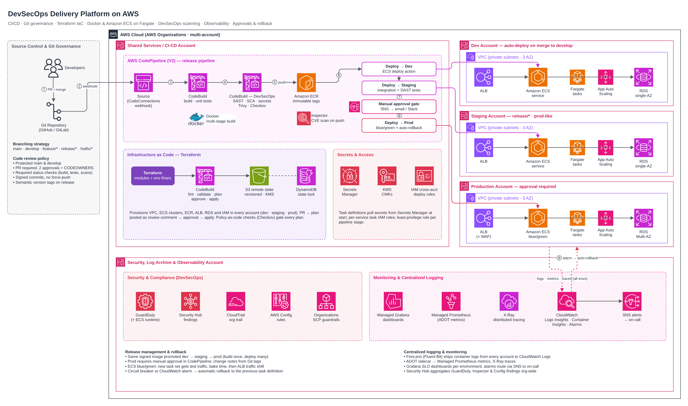

# DevSecOps Delivery Platform on AWS

Reference implementation of a DevSecOps delivery platform: Git governance, Terraform IaC, Docker,
Amazon ECS on Fargate, DevSecOps scanning, observability, approvals and rollback, built around a tiny
Node.js sample app.



- Build plan and progress: [PLAN.md](PLAN.md)
- Git branching and review rules: [docs/git-governance.md](docs/git-governance.md)
- Architecture diagrams (ECS and EKS, draw.io sources included): [docs/architecture/](docs/architecture/)

## Phases

1. AWS ECS on Fargate + Terraform + CodePipeline (current)
2. AWS EKS quick test (later)
3. Azure quick test (later)

## Repository layout

```
app/          sample Node.js app (Step 1)
scripts/      cloud-agnostic security scan scripts (Step 6)
buildspecs/   CodeBuild specs (Step 5)
infra/aws/    Terraform bootstrap, modules and environments (Step 2+)
docs/         architecture and runbooks
```
