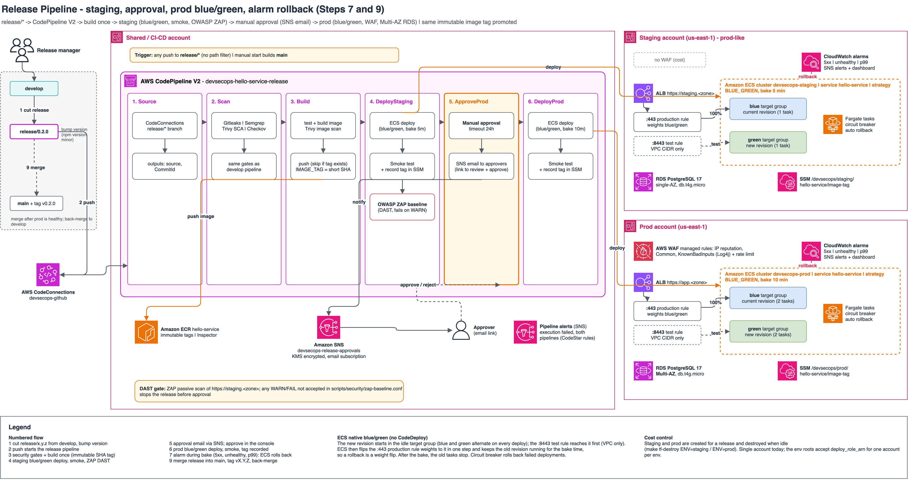
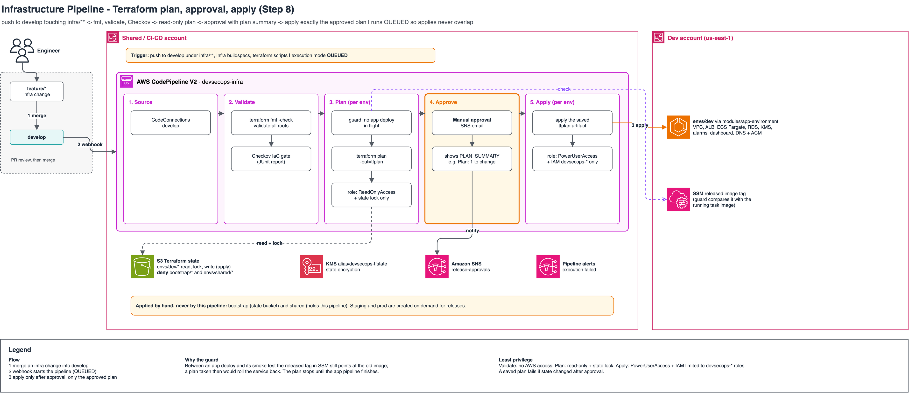
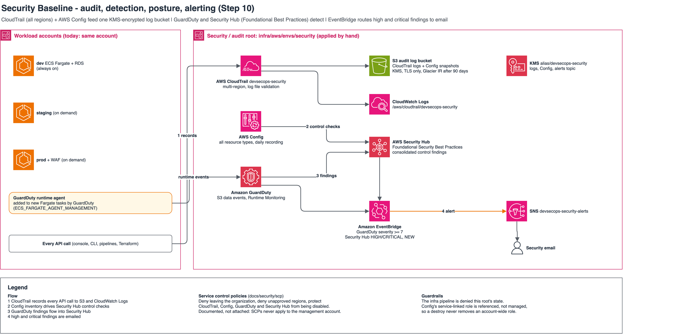

# DevSecOps Delivery Platform on AWS

Reference implementation of a DevSecOps delivery platform: Git governance, Terraform IaC, Docker,
Amazon ECS on Fargate, DevSecOps scanning, observability, approvals and rollback, built around a tiny
Node.js sample app.


The diagram above is the target multi-account design. The sections below show what is built today.

| Target | As built |
|---|---|
| Separate shared, dev, staging, prod and security accounts | One account; every root accepts `deploy_role_arn` to split later |
| Terraform plan posted as a PR comment | Plan summary in the approval email, full plan in the build log |
| Grafana, Prometheus, X-Ray, FireLens | CloudWatch alarms, dashboards and Container Insights |
| SCPs on workload accounts | Documented in `docs/security/scp`, not attached (management account) |

- Build plan and progress: [PLAN.md](PLAN.md)
- Runbooks (release, rollback, infra change, secret rotation, teardown): [docs/runbooks/](docs/runbooks/)
- Git branching and review rules: [docs/git-governance.md](docs/git-governance.md)
- Architecture diagrams (ECS and EKS, draw.io sources included): [docs/architecture/](docs/architecture/)

## CI/CD pipeline (as built)


## Release pipeline: staging, approval, prod blue/green



A push to `release/*` builds the image once and promotes the same tag: staging (ECS blue/green, smoke,
OWASP ZAP baseline) -> manual approval by SNS email -> prod (ECS blue/green with bake time, WAF,
Multi-AZ RDS). All three environments use `infra/aws/modules/app-environment`; staging and prod are
created for a release and destroyed when idle:

```sh
make tf-plan ENV=staging && make tf-apply ENV=staging
make tf-plan ENV=prod && make tf-apply ENV=prod
git checkout -b release/0.2.0 develop && (cd app && npm version minor --no-git-tag-version)
make tf-destroy ENV=prod && make tf-destroy ENV=staging
```

## Infrastructure pipeline: plan, approval, apply



A push to `develop` that touches `infra/**` runs `devsecops-infra`: fmt, validate and Checkov, then a
plan with read-only credentials, an approval email showing the plan summary, and an apply of exactly
that saved plan. It manages the workload environments listed in `infra_pipeline_environments`
(dev by default). Bootstrap and shared, which holds the pipeline itself, are applied by hand. The plan
stops while an app deployment is still in flight so it never rolls a release back.

## Observability and automatic rollback

Each environment has CloudWatch alarms on target 5xx, unhealthy tasks and p99 latency, attached to the
ECS service as deployment alarms: if one fires during a deployment (including the blue/green bake time),
ECS rolls back to the previous revision. Alarms notify the environment's SNS alert topic, each
environment has a dashboard (`devsecops-<env>`), and both pipelines email on a failed execution.
Bake time must stay above the alarm detection time (about 3 minutes from first error to ALARM).

Prove it with the drill, which deploys a revision that passes `/health` but returns 500 to users:

```sh
scripts/ops/rollback-drill.sh devsecops-staging hello-service https://staging.<zone>
```

## Security baseline



`infra/aws/envs/security` enables a multi-region CloudTrail, AWS Config, GuardDuty (with Fargate runtime
monitoring) and Security Hub (Foundational Security Best Practices); high and critical findings are
emailed. Details, SCP examples and a test command: [docs/security/README.md](docs/security/README.md).

## Dev environment network


## Phases

1. AWS ECS on Fargate + Terraform + CodePipeline (current)
2. AWS EKS quick test (later)
3. Azure quick test (later)

## Repository layout

```
app/          sample Node.js app (Step 1)
scripts/      cloud-agnostic security scan scripts (Step 6)
buildspecs/   CodeBuild specs (Step 5)
infra/aws/    Terraform bootstrap, modules and environments (Step 2+)
docs/         architecture and runbooks
```
