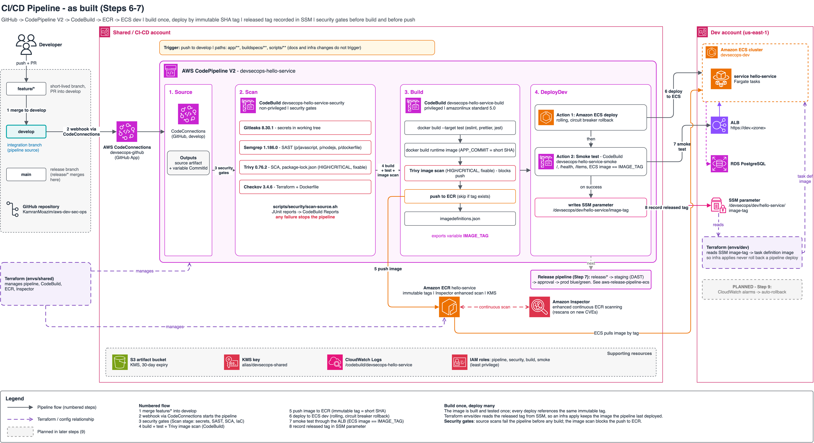
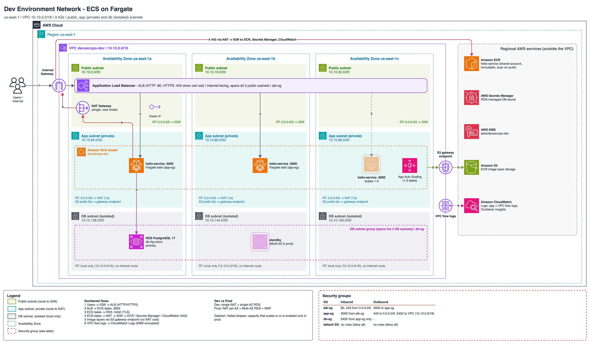

# DevSecOps Delivery Platform on AWS

Reference implementation of a DevSecOps delivery platform: Git governance, Terraform IaC, Docker,
Amazon ECS on Fargate, DevSecOps scanning, observability, approvals and rollback, built around a tiny
Node.js sample app.


- Build plan and progress: [PLAN.md](PLAN.md)
- Git branching and review rules: [docs/git-governance.md](docs/git-governance.md)
- Architecture diagrams (ECS and EKS, draw.io sources included): [docs/architecture/](docs/architecture/)

## CI/CD pipeline (as built)



## Release pipeline: staging, approval, prod blue/green


A push to `release/*` builds the image once and promotes the same tag: staging (ECS blue/green, smoke,
OWASP ZAP baseline) -> manual approval by SNS email -> prod (ECS blue/green with bake time, WAF,
Multi-AZ RDS). All three environments use `infra/aws/modules/app-environment`; staging and prod are
created for a release and destroyed when idle:

```sh
make tf-plan ENV=staging && make tf-apply ENV=staging
make tf-plan ENV=prod && make tf-apply ENV=prod
git checkout -b release/0.2.0 develop && (cd app && npm version minor --no-git-tag-version)
make tf-destroy ENV=prod && make tf-destroy ENV=staging
```

## Dev environment network



## Phases

1. AWS ECS on Fargate + Terraform + CodePipeline (current)
2. AWS EKS quick test (later)
3. Azure quick test (later)

## Repository layout

```
app/          sample Node.js app (Step 1)
scripts/      cloud-agnostic security scan scripts (Step 6)
buildspecs/   CodeBuild specs (Step 5)
infra/aws/    Terraform bootstrap, modules and environments (Step 2+)
docs/         architecture and runbooks
```
